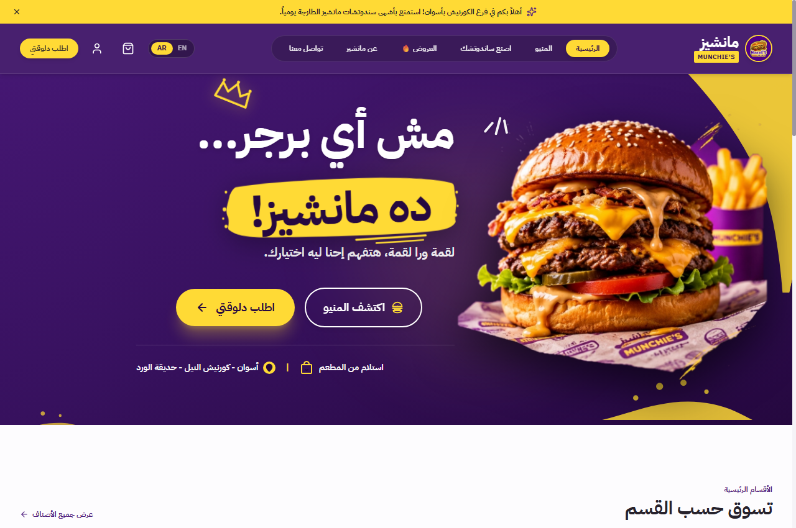
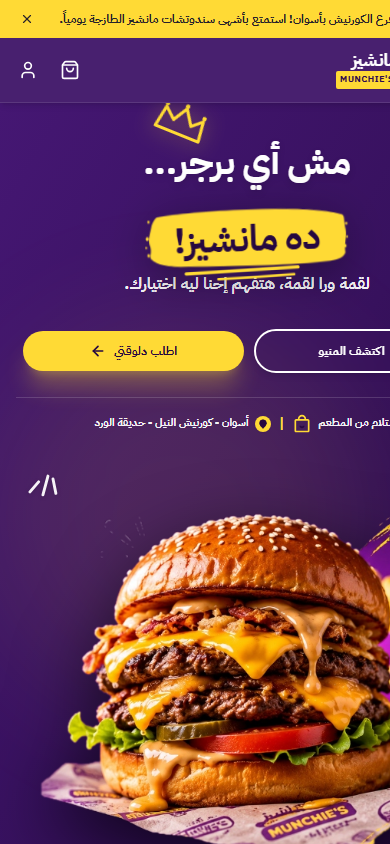

# Munchie's Restaurant & Ordering Platform 🍔

A modern, high-performance bilingual (Arabic RTL & English LTR) restaurant website and ordering platform built for **Munchie's** in Aswan, Egypt.



---

## 🌟 Highlights & Features

### 🛍️ Customer Experience
- **Bilingual Interface**: Native Arabic (RTL) and English (LTR) with instant language switching and localized typography.
- **Brand Identity**: Modern Light design utilizing Munchie's signature Purple (`#512080`) and Brand Yellow (`#FFDA35`), with appetizing food photography and crisp floating elements.
- **Full Interactive Menu**: Authentic product catalog extracted from flyers — Classic Burgers, Gourmet Sandwiches, VIP Menu, Fat Burgers, Fries Cups/Conos, and Loaded Specialties.
- **Item Customization**: Bread selection (Kaiser, French, Tortilla, Fat Bun), extra toppings, specialty cheeses, combo add-ons, and kitchen notes.
- **Persistent Cart**: Zustand store with localStorage persistence across page reloads and language toggles.
- **Streamlined Checkout (MVP)**:
  - Branch Pickup at Rose Garden in front of Al Raya - Corniche, Aswan.
  - Cash on Pickup payment model.
  - Nearest available preparation time (ASAP).
  - Clear "Under Construction" badge for delivery zones.
- **Real-Time Order Tracking**: Multi-step visual order progression with atomic cancellation rules (cancellation permitted before kitchen begins preparation).
- **Authentication**: Seamless Email/Password registration and sign-in.

<div align="center">
  
</div>

### 🛠️ Admin Dashboard (`/admin`)
- **Operational Queue**: Real-time incoming orders with Accept, Prepare, Ready, and Complete actions.
- **Catalog Management**: Product availability toggling, price tracking, and categories.
- **Operations & Working Hours**: Automatic weekly schedule (Africa/Cairo timezone) with manual emergency order-acceptance shutoff.
- **Security & Audit Log**: Traceable history of administrative decisions.

---

## 🛠️ Tech Stack

- **Frontend**: React 19 + TypeScript + Vite 8
- **Styling**: Tailwind CSS v4 + Custom Theme Design Tokens
- **Icons**: Lucide React
- **State Management**: Zustand with persistent storage
- **Localization**: react-i18next with RTL logical properties
- **Validation**: React Hook Form + Zod
- **Backend & Database**: Firebase Auth, Cloud Firestore, Cloud Storage, Cloud Functions
- **Notifications**: react-hot-toast

---

## 📁 Repository Structure

```text
Munchies/
├── docs/
│   ├── menu-references/              # Original menu flyers and photo references
│   └── screenshots/                  # Desktop and mobile UI previews
├── munchies-app/
│   ├── functions/                    # Cloud Functions for Firebase
│   ├── public/                       # Static public assets (brand images, icons)
│   ├── src/
│   │   ├── components/               # UI components (layout, menu, cart, order, etc.)
│   │   ├── context/                  # React contexts (Auth, Language, etc.)
│   │   ├── lib/                      # Firebase config, utils, i18n
│   │   ├── pages/                    # Customer and Admin view pages
│   │   ├── store/                    # Zustand stores (cart, order, catalog)
│   │   └── types/                    # TypeScript interfaces and types
│   ├── .env.example                  # Environment configuration template
│   ├── firebase.json                 # Firebase Hosting & emulator configuration
│   ├── firestore.rules               # Cloud Firestore security rules
│   └── package.json                  # Frontend dependencies and scripts
├── Munchies_Website_Blueprint_v1.2.md # Product blueprint & architecture documentation
└── README.md
```

---

## 🚀 Getting Started

### 1. Prerequisites
- **Node.js** (v18 or higher recommended)
- **npm** or **yarn** / **pnpm**

### 2. Installation
Navigate into the application directory and install dependencies:
```bash
cd munchies-app
npm install
```

For Cloud Functions:
```bash
cd functions
npm install
cd ..
```

### 3. Environment Setup
Copy the environment example file in `munchies-app/`:
```bash
cp .env.example .env.local
```
Fill in your Firebase project configuration keys in `.env.local`.

### 4. Run Development Server
```bash
npm run dev
```
Open your browser at `http://localhost:5173`.

### 5. Build for Production
```bash
npm run build
```
Production build assets will be generated in `munchies-app/dist/`.

---

## 📍 Restaurant & Branch Details
- **Location**: حديقة الورد أمام الراية – فرع الكورنيش، أسوان (Rose Garden in front of Al Raya - Corniche Branch, Aswan)
- **Phone**: `01025707026`
- **Hours**: Daily 12:00 PM – 03:00 AM (Africa/Cairo)
